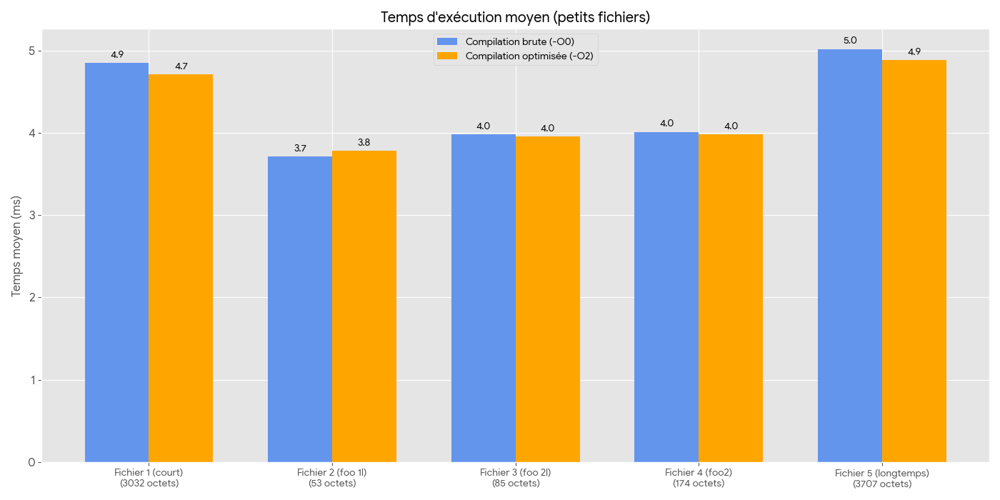
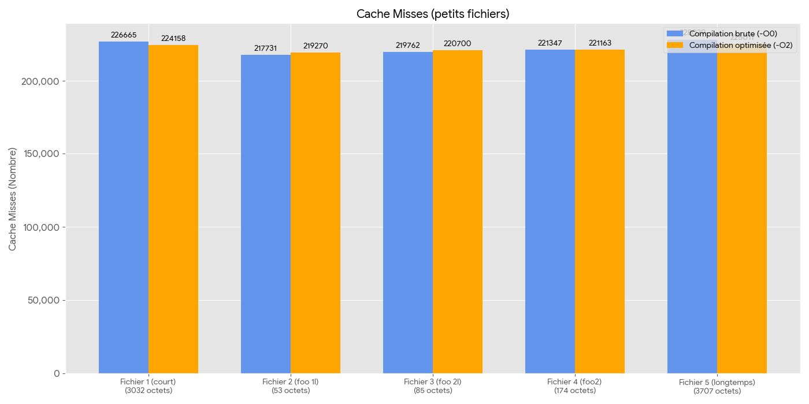
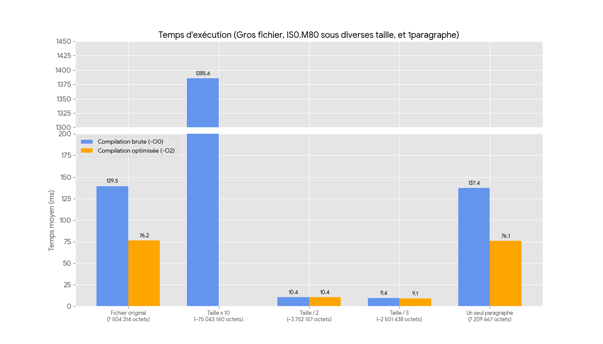
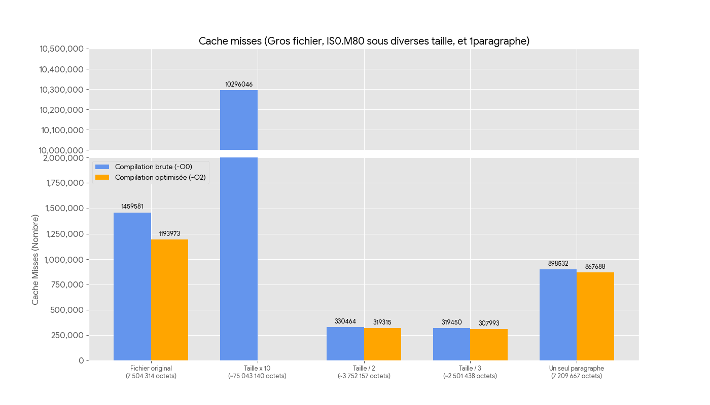
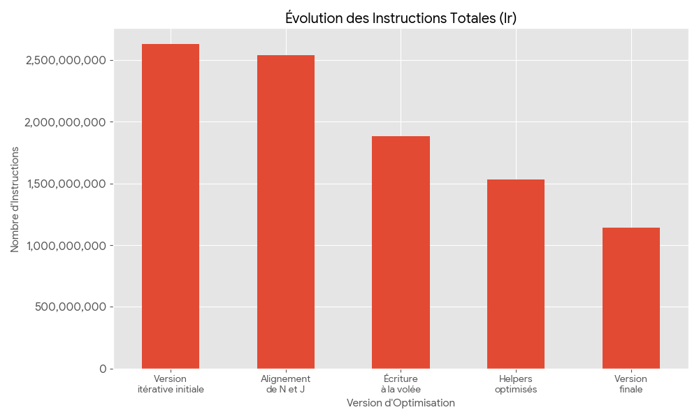
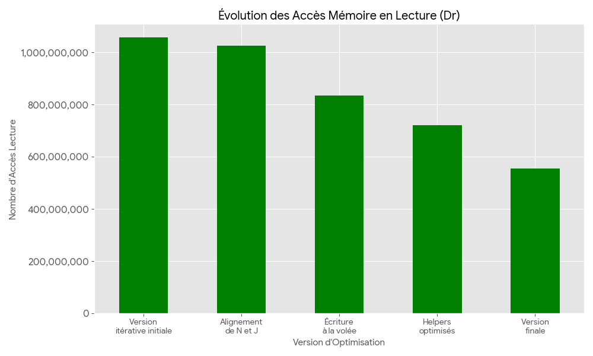
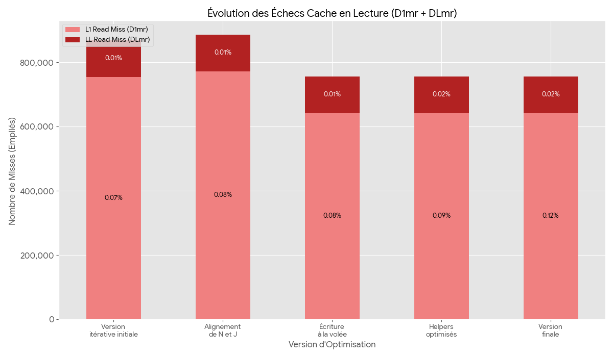
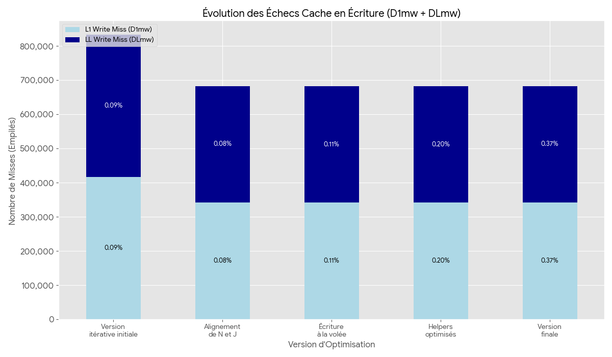

# AODjustify - Justification Optimale de Texte

Ce projet est une implémentation en C du problème de justification optimale de texte (formatage de paragraphes) en utilisant la programmation dynamique, dans le cadre du TP "Algorithmique et Optimisation Discrète".

L'objectif est de lire un fichier texte, après s'être assuré qu'il est au format `ISO-8859-1`, de le découper en paragraphes, et de justifier chaque paragraphe selon une largeur `M` donnée en minimisant son coût (représenté par la fonction cubique $C(D) = \sum (M - \Delta(i,k))^3$).

Le rendu est accompagné d'un rapport de quelques pages qui détaille notre approche algorithmique, les choix de conception, les attentes théoriques et une analyse succincte des résultats empiriques. Dans ce README, nous détaillons les étapes annexes, nottamment la gestion des erreurs et les tests (1), le fonctionnement général du programme (2) et son architecture (4), les outils de benchmarking utilisés (3) ainsi qu'une présentation des annexes composées principalement des mises en forme des résultats de nos benchmarks (5).

Il est important de placer tous les fichiers d'entrée au format `.in` dans le répertoire `data/`. Ce répertoire est initialement vide et doit contenir les fichiers d'entrée pour les tests.

## Table des Matières

1. [Validation des Prérequis et Tests de Robustesse](#étape-1--validation-des-prérequis-et-tests-de-robustesse)  
2. [Compilation et Utilisation (Makefile)](#étape-2--compilation-et-utilisation-makefile)
3. [Les Outils d'Analyse](#étape-3--les-outils-danalyse)
4. [Structure du Projet](#étape-4--structure-du-projet)
5. [Annexes](#étape-5--annexes)

## Étape 1 : Validation des Prérequis et Tests de Robustesse

Avant d'implémenter l'algorithme de programmation dynamique, la première étape consiste à vérifier la validité du fichier et à mettre en place la gestion des erreurs, conformément aux spécifications. Ces vérifications sont réalisées en trois étapes, la première directement dans le [main](../src/main.c) et les deux autres dans un fichier dédié, [check.c](../src/check.c). En effet la commande `file -bi <filename>` ne peut pas tout vérifier à elle seule (fichiers spéciaux, permissions, etc.) la vérification a lieu ainsi :

1.  Ouverture du fichier en lecture seule avec open() et l'option `O_NONBLOCK` afin de s'assurer : 
    * De l'existence du fichier.
    * Que l'utilisateur a les permissions idoines.
    On en profite au passage pour récupérer le descripteur de fichier qui nous servira pour la suite (jusqu'au mmap).

2.  La fonction `getSize()` utilise `fstat()` pour :
    * Récupérer la taille du fichier.
    On en profite au passage pour conserver la taille du fichier qui nous servira pour mmaper le fichier en mémoire.

3.  Enfin, la fonction `fileBI()` crée un processus qui communiquera avec son père via deux pipes (branchées sur `stdout` et `stderr`). Il lancera la commande `file -bi <filename>` pour vérifier :
    * Que le fichier est bien un fichier régulier.
    * Qu'il est bien au format texte.
    * Et enfin qu'il est bien encodé en `ISO-8859-1` (ou en `us-ascii`).    
    Le résultat de la commande est capturé dans le buffer passé en argument. Il sera, le cas échéant, affiché à l'utilisateur.

> Un script de test dédié, `make tests`, a été créé pour contrôler la bonne gestion des erreurs en simulant divers scénarios et fichiers de test.

### Le Script de test

Le script valide que le programme gère correctement les erreurs système et les contraintes de l'énoncé avant même de tenter de justifier un texte :

* **`T0 Test d'usage`** : Vérifie que le programme affiche une erreur "Usage" s'il est lancé sans le bon nombre d'arguments.
* **`T1 Test de fichier ISO-8859-1`** : Test de succès. Vérifie qu'un fichier `ISO-8859-1` valide est traité correctement et retourne une coût nul (0).
* **`T2 Test de fichier UTF-8`** : Vérifie que le programme détecte (via `file -bi`) un fichier `UTF-8` et retourne une erreur contenant "ISO-8859-1".
* **`T3 Test de fichier manquant`** : Vérifie que le programme gère proprement l'erreur "No such file or directory" si le `.in` n'existe pas.
* **`T4 Test de fichier sans permission`** : Vérifie que le programme gère proprement l'erreur "Permission denied" si le fichier n'a pas les permissions nécessaires.
* **`T5 Test de commande file -bi`** : Teste la gestion des possibles échecs de la commande `file -bi`, ici elle n'est pas exécutable par exemple.
* **`T6 Test avec un répertoire`** : Vérifie que le programme retourne une erreur s'il est lancé sur un répertoire au lieu d'un fichier.

## Étape 2 : Compilation et Utilisation (Makefile)

Le `Makefile` est le point d'entrée unique pour compiler, exécuter et analyser le projet.

### Cibles Principales (Compilation et Exécution)

* `make help`
    Affiche l'aide complète des cibles `make` et des variables d'environnement.

* `make` ou `make all`
    Compile le programme avec les options par défaut (`-g -O0`). L'exécutable `AODjustify` est créé dans `bin/`.

* `make O=2`
    Compile le programme en activant les optimisations (`-O2`).

* `make run`
    Exécute le programme avec les variables `M` et `FILE` (voir ci-dessous).

* `make clean`
    Supprime les fichiers objets (`obj/`), l'exécutable (`bin/`) et le résultat des benchmarks (`benchmarks/`).

### Cibles d'Analyse et de Profilage

* `make tests`
    Lance le script de test `.tools/tests.sh` pour valider la robustesse (voir les [détails](#le-script-de-test) du script).

* `make valgrind`
    Exécute le programme sous `valgrind` (outil `memcheck`) pour détecter les fuites mémoire et les erreurs d'accès.

* `make cache`
    Lance le programme sous `valgrind --tool=cachegrind` pour l'analyse des défauts de cache.

* `make perf`
    Lance le programme sous `perf stat` (si `perf` est installé).

* `make massif`
    Lance le programme sous `valgrind --tool=massif` pour observer l'utilisation du tas (`heap`).

* `make clean-cache`
    Nettoie uniquement les fichiers de sortie de `cachegrind` et `massif`.

### Variables d'Environnement

Ces variables permettent de configurer les cibles `make` :

* `M=<largeur>`
    Spécifie la largeur de justification (Défaut : 80).

* `FILE=<chemin_fichier>`
    Spécifie le fichier d'entrée (Défaut : `data/ALaRechercheDuTempsPerdu-1paragraphe-2025-ISO-8859-1`).

* `P_LIST=<event_perf>`
    Spécifie les événements à mesurer pour `make perf` (Défaut : `cache-references,cache-misses,cycles,instructions`).

## Étape 3 : Les Outils d'Analyse

L'analyse de performance de ce projet repose sur quatre outils principaux, tous accessibles via `make` :

1.  **`valgrind --tool=memcheck` (via `make valgrind`)**
    Outil principal pour la validation de la mémoire. Nous l'avons utilisé pour détecter les fuites mémoire, principalement en simulant des erreurs au cours de l'exécution pour vérifier que tous les cas de sorties non habituelles libéraient correctement la mémoire allouée. Le programme tel que livré ne comporte ni de fuites mémoire, ni d'erreurs d'accès.

2.  **`valgrind --tool=cachegrind` (via `make cache`)**
    C'est l'outil central de l'analyse de performance (Q5, Q6). Il simule la hiérarchie cache (L1, LL) et un prédicteur de branche. Il permet de compter précisément les accès en lecture (`Dr`),   en écriture (`Dw`), les "misses" des caches de haut niveau (`D1mr`, `D1mw`), ainsi que les "misses" les plus coûteuses, celles du cache le plus bas (`DLmr`, `DLmw`).

3.  **`perf stat` (via `make perf`)**
    Alternative "native" (noyau Linux) à `cachegrind`. `perf` ne simule pas, on peut donc s'appuyer sur ses mesures pour confirmer les résultats de `cachegrind`. Nous avons lancé plusieurs benchmarks en utilisant principalement les compteurs `cache-references`, `cache-misses`, `cycles` et `instructions`. C'est aussi l'outil qui nous a permis de mesurer les différents temps d'exécution pour tous les fichiers de test.

4.  **`valgrind --tool=massif` (via `make massif`)**
    Nous n'avons pas eu le temps d'utiliser Massif.

## Étape 4 : Structure du Projet

```
.
├── bin/
│   └── AODjustify              # L'exécutable compilé
├── data/
│   ├── *.in                    # Fichiers d'entrée pour les tests
│   └── *.out                   # Fichiers de sortie (y compris les solutions attendues)
├── doc/
│   └── index.html              # (Cible pour la documentation Doxygen)
├── include/
│   ├── common.h                # En-têtes généraux et structures communes
│   ├── check.h                 # En-tête pour la validation de fichier
│   ├── parse.h                 # En-tête pour l'analyse (parsing)
│   ├── justify.h               # En-tête pour la programmation dynamique
│   └── out.h                   # En-tête pour l'écriture du fichier de sortie
├── obj/
│   └── *.o                     # Fichiers objets compilés
├── rapport/
│   ├── annexes
│   │   ├── graphiques/
│   │   │   └── *.png           # Graphiques de performance
│   │   └── donnees/
│   │      ├── cachegrind
│   │      |     └── *.out      # Fichiers cachgrind/massif bruts
│   │      └── tableur
│   │            ├── *.xslx     # Résultats bruts des benchmarks
│   │            └── *.csv      # Résultats bruts des benchmarks
│   │── pdf/
│   │   ├── rapport.pdf         # Rapport en format PDF (Q4 a Q6)
│   │   └── theorie.pdf         # Réponses aux questions théoriques (Q1 à Q3)
│   └── tex/
│       ├── rapport.tex         # Sources LaTeX du rapport
│       └── theorie.tex         # Sources LaTeX des questions théoriques
├── src/
│   ├── main.c                  # Architecture principale du programme
│   ├── check.c                 # Vérification du fichier (taille, format, etc.)
│   ├── parse.c                 # mmapage et parsing du fichier d'entrée
│   ├── justify.c               # Algorithme itératif de justification de texte
│   └── out.c                   # Écriture du fichier de sortie (avec buffer)
├── tools/
│   └── tests.sh                # Script de test pour la validation des erreurs
├── .gitignore
├── AUTHORS
├── Doxyfile
├── README.md
└── Makefile

```

## Étape 5 : Annexes

Cette section contient les résultats bruts et les graphiques utilisés pour l'analyse de performance du rapport (Q5, Q6).

### 1. Extrait de Résultat Cachegrind (Brut)

Voici un extrait de la sortie de `cachegrind` pour le fichier principal des benchmarks (compilé en `-O0`). Ce fichier n'est la base de notre analyse de cache, nous lui avons préféré la version `ISO-8859-1.M80` car elle a l'avantage de posséder une structure plus réaliste (plusieurs paragraphes de tailles variées) tout en conservant la même taille que le fichier principal (1paragraphe).

```
desc: I1 cache:         32768 B, 64 B, 8-way associative
desc: D1 cache:         32768 B, 64 B, 8-way associative
desc: LL cache:         67108864 B, 64 B, direct-mapped
cmd: bin/AODjustify 80 data/ALaRechercheDuTempsPerdu-1paragraphe-2025-ISO-8859-1
events: Ir I1mr ILmr Dr D1mr DLmr Dw D1mw DLmw Bc Bcm Bi Bim
fl=./csu/../csu/libc-start.c
fn=__libc_start_main@@GLIBC_2.34

[...]

fl=???
fn=(below main)
0 12 1 1 2 0 0 3 0 0 0 0 1 1
fn=???
0 5025925 35 29 2512933 20 0 11 1 1 11 7 2512911 39
summary: 1139944750 1620 1587 554597077 641632 113815 91909595 340888 340583 131906290 4174871 2609644 239
```
Les fichiers bruts sont disponibles dans les annexes  `rapport/annexes/cachegrind`, voici par exemple le résultat final : [logs](../rapport/annexes/donnees/cachegrind/cachegrind_6_final_O0.out).

### 2. Graphiques de Performance (q6)

Ces graphiques répondent directement à la question 6. Ils comparent les performances (temps et "misses") entre la compilation brute (`-O0`) et optimisée (`-O2`) sur tous les fichiers de tests fournis (dans le répertoire [`data/`](data/)). Au vu des différences importantes d'échelles nous les avons séparés en deux catégories : les petits et les gros fichiers. Pour ajouter un peu de piment, nous avons comparé les résultats du fichier principal (1paragraphe) avec une déclinaison du fichier `ISO-8859-1.M80` (Taille originale, taille / 2, taille / 3, taille x 10).

#### Analyse des fichiers de test de petite taille

Les graphiques suivants comparent le temps d'exécution et les défauts de cache pour les petits fichiers de test fournis dans `data/` :

- Le graphique "Temps d'exécution (Petits Fichiers)" met en évidence le coût fixe lié au démarrage et à l'initialisation (allocation, parsing, I/O).
- Le graphique "Cache Misses (Petits Fichiers)" montre que, pour ces tailles, les différences de nombre de "misses" entre -O0 et -O2 sont généralement faibles ; les gains en temps proviennent surtout des optimisations CPU et de la réduction des instructions.




#### Analyse des fichiers de benchmark de grande taille

Les graphiques ci-dessous portent sur les fichiers de plus grande taille. Ils mettent en évidence la complexité en pratique et l'impact des optimisations sur les accès mémoire.

Le comportement observé confirme une complexité proche de O(N) : le temps d'exécution croît linéairement avec la taille des données traitées.




Ces graphiques (basés sur le fichier `1paragraphe`) illustrent l'impact de chaque optimisation successive, depuis la version "itérative initiale" jusqu'à la "version finale".

Cette série de graphiques illustre l'effet cumulatif des optimisations successives implémentées durant le projet :

- Réduction du nombre total d'instructions exécutées.
- Diminution des accès mémoire inutiles (lectures/écritures).
- Effet limité mais observable sur les défauts de cache : certaines optimisations déplacent le travail du CPU sans réduire fortement les cache misses quand le goulet d'étranglement est la bande passante mémoire.





#### Évolution des Échecs Cache (Cache Misses)

Ces graphiques prouvent que, bien que les accès aient été massivement réduits, les défauts de cache (le "noyau dur" incompressible) restent stables, confirmant que l'algorithme est "memory-bound".




### Fichiers bruts et annexes

Les résultats bruts de `cachegrind` et des autres outils sont fournis dans `rapport/annexes/donnees/cachegrind/`. Ils contiennent les sorties complètes utilisées pour produire les graphiques présents dans ce README.

Pour consulter les logs bruts utilisés pour l'analyse finale, voir :

@include rapport/annexes/donnees/cachegrind/cachegrind_6_final.out